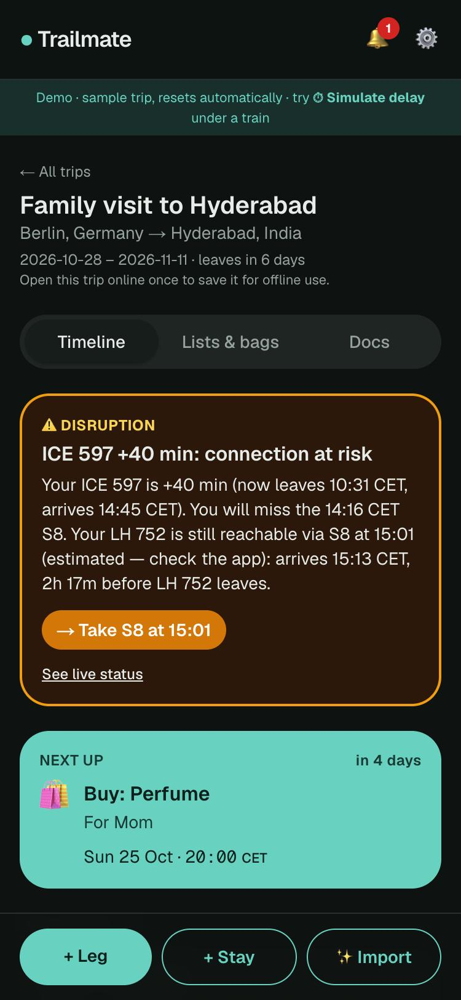
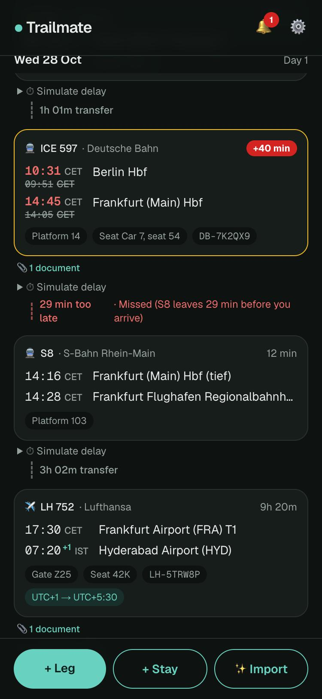
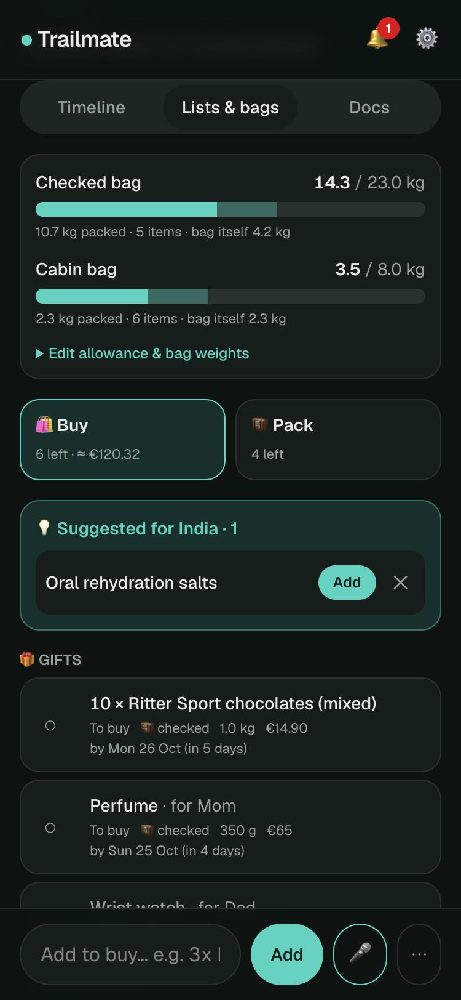
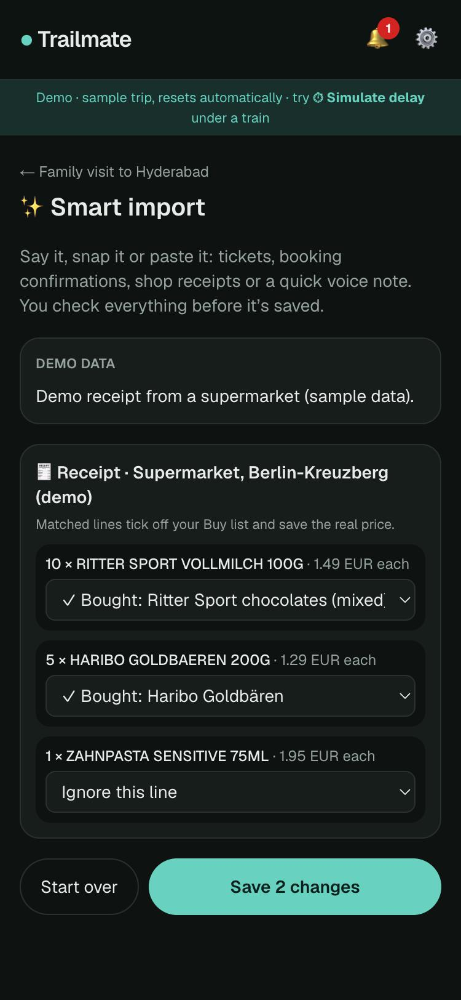
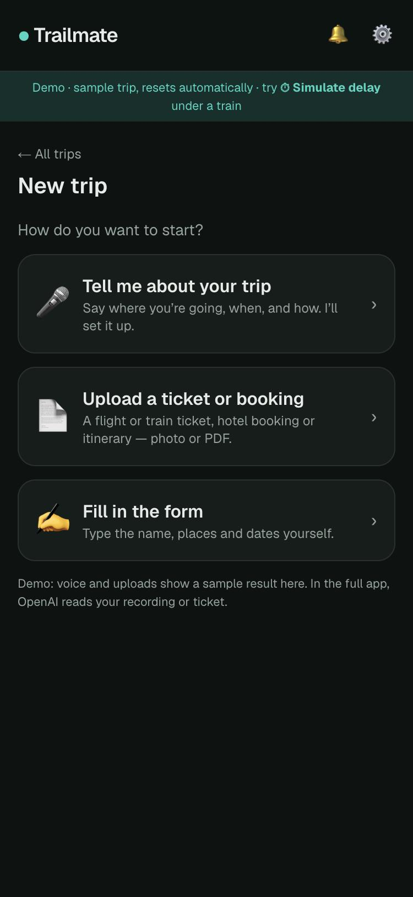
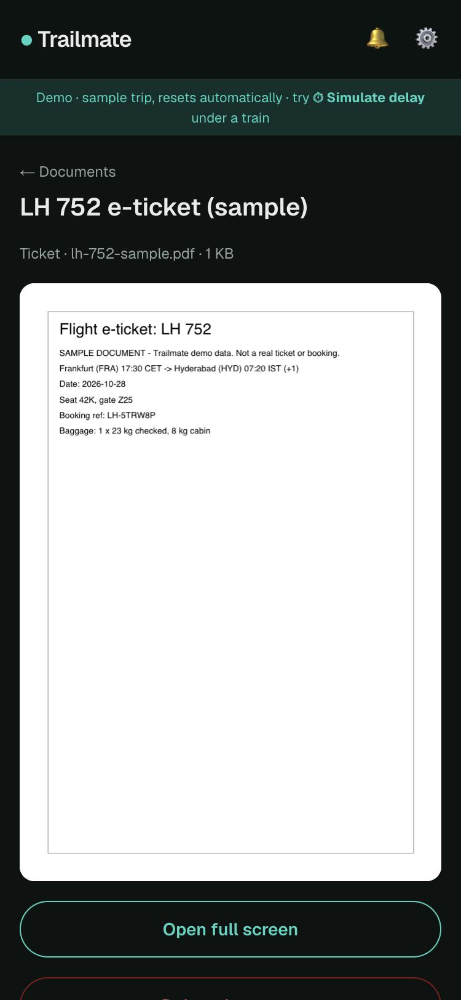

# Trailmate

**A mobile-first travel companion that keeps a whole trip in one place — stays, trains and flights, packing and shopping lists, documents — and tells you what to do when something goes wrong.**

**[▶ Try the live demo](https://trailmate-demo.onrender.com)** — no sign-up; tap **⏱ Simulate delay** under the ICE.
<sub>Free hosting: the first visit after a quiet spell takes about a minute to wake up.</sub>

| Live disruption check | Timeline across time zones | Lists & baggage |
| :---: | :---: | :---: |
|  |  |  |
| **Smart import (AI)** | **Start a trip by voice** | **Documents, offline** |
|  |  |  |

## What it does

- **One timeline** for legs (train, flight, taxi…) and stays, every time shown in the local zone of its place (`17:30 CET → 07:20⁺¹ IST`).
- **Trip checks**: nights with nowhere to sleep, double-booked stays, tight or missed connections, arriving after the hotel's latest check-in.
- **Live disruption check**: when a train is late or cancelled, it works out what breaks and the next way through — *"You will miss the 14:16 S8. Your flight is still reachable via the S8 at 15:01."*
- **Pack & Buy lists** with gifts per person, a **baggage weight tracker** (including the empty suitcase) and **country rules** for suggestions and customs reminders.
- **Reminders & push notifications**: buy-by, packing evening, "leave now" (updated with delays), check-in; quiet hours in the zone you're in.
- **Smart import with AI**: say it, snap it or paste it — a voice note, a ticket PDF, a receipt photo — and review a draft before anything is saved. You can even **create a whole trip by talking**.
- **Offline-first**: the trip, lists and documents (including PDFs) open in airplane mode; ticks made offline sync later.

## Interesting problems

- **Time zones, done properly.** Every instant is stored in UTC with the IANA zone of its place; forms take the time printed on the ticket. Caught along the way: a form hint showing *today's* offset instead of the trip date's (DST changes mid-trip), and a "you arrive 01:00" that was really a Dubai stopover.
- **One rule engine for everything.** A delay only changes a leg's effective times; connections, trip checks, "leave now" and the disruption banner all re-derive from that. "Simulate delay" runs the exact same pipeline as a real status change.
- **Offline on a server-rendered app.** A hand-written service worker (network-first pages, cache-first files) plus a "save this trip" step that also captures scripts loaded on demand (the PDF viewer only worked offline after that). Offline edits go through an idempotent outbox with last-write-wins.
- **AI you don't have to trust blindly.** OpenAI returns a strict JSON schema; every field is re-checked (time zones, times, duplicates) before the traveler sees it, nothing is saved without review, and a PDF containing *"ignore previous instructions…"* was tested and ignored.
- **Unreliable data sources.** Every external call has a timeout, a retry and a fallback; the public Deutsche Bahn API failed for days during development and the app kept working on the timetable.

## Tech

**Next.js 15** (App Router, server actions) · **TypeScript** · **Prisma + SQLite** · **Tailwind CSS v4** · **Web Push** · **Service worker / PWA** · **OpenAI** (Responses API with Structured Outputs, `gpt-transcribe`) · **pdf.js** · **zod** · **Docker** · **Render** · **GitHub Actions**

95 unit tests (`npm test`), CI on every pull request (types, lint, tests, build), and changes reviewed through pull requests. Design notes: [ARCHITECTURE.md](ARCHITECTURE.md).

## Public demo

A free, public demo runs on [Render](https://render.com) from this repo
(`render.yaml` + `Dockerfile`). It's a separate, demo-only copy:

- **No passphrase** — anyone can look around.
- **Sample trip only**, recreated every time the server starts (Berlin → Frankfurt → Hyderabad, departing 7 days from today).
- **Uploads off**, and smart import uses the **built-in demos**, so it costs nothing.
- **⏱ Simulate delay** and the pretend-time tools are on — try +40 min on the ICE.
- The free plan **sleeps after 15 minutes** without visitors; the first visit after that takes about a minute.

### Deploy it yourself (free)

1. Sign in at [render.com](https://render.com) with GitHub and allow access to this repository.
2. **New → Blueprint**, pick this repo; Render reads `render.yaml` and creates the `trailmate-demo` web service on the free plan.
3. Wait for the first build (a few minutes). Your demo is at `https://trailmate-demo.onrender.com` (or the URL Render shows).
4. Every push to `main` redeploys it.

Run the same container locally:

```bash
docker build -t trailmate-demo .
docker run -p 3000:10000 -e PORT=10000 -e DEMO_MODE=1 -e IMPORT_MODE=mock -e DB_REST_MODE=mock trailmate-demo
```

Your own copy (on your laptop, `DEMO_MODE` unset) keeps your trips, the passphrase login and the AI import.

## Setup

Requires Node 20+.

```bash
npm install
cp .env.example .env          # then: set APP_PASSWORD; npm run push:keys, paste the keys into .env
npx prisma migrate dev        # creates prisma/dev.db and the tables
npm run db:seed               # loads the Berlin → Hyderabad demo trip
npm run dev                   # http://localhost:3000
```

Useful scripts:

| Script              | What it does                                       |
| ------------------- | -------------------------------------------------- |
| `npm run dev`       | Start the app in development mode                  |
| `npm run db:seed`   | Wipe the database and load the demo trip again     |
| `npm run db:reset`  | Drop the database, re-run migrations and the seed  |
| `npm run db:studio` | Open Prisma Studio to browse/edit the data         |
| `npm test`          | Unit tests for checks, baggage, rules, reminders (`tests/`) |
| `npm run push:keys` | Generate a VAPID key pair for Web Push              |
| `npm run build && npm start` | Production build — needed to test offline mode |

The demo trip always departs **7 days from today**, so "Next up" and the
countdowns look realistic whenever you seed.

## Login

Trailmate is for one traveler, so there are no accounts: one passphrase,
`APP_PASSWORD` in `.env`. `npm run dev` and `npm start` listen on every
network interface, so without it anyone on the same Wi-Fi could open your
trips and download your passport copy.

- `/login` asks for the passphrase and sets a signed session cookie
  (HttpOnly, SameSite=Lax, 90 days). It is signed with `APP_SECRET`, or a key
  derived from the passphrase if that's empty; changing either logs every
  device out. **Settings → Log out** ends the session on this device.
- `src/middleware.ts` checks the cookie on every page and API route. Pages
  redirect to `/login`, API calls get `401`. Public: `/login`, the offline
  fallback, `/_next/static`, icons, `/manifest.webmanifest`, `/sw.js`,
  `/pdf.worker.min.mjs`, and `POST /api/cron/sweep` (protected by
  `CRON_SECRET` instead).
- No `APP_PASSWORD`: in development the app stays open (the login page says
  so); in production every request gets a `503` "set APP_PASSWORD" page.
- The cookie is `Secure` in production, except over plain `http` (like
  `npm start` opened from a phone at `http://192.168.x.x:3000`), where the
  browser would drop a Secure cookie and you could never log in.
- Offline: pages saved while logged in stay available; a redirect to `/login`
  or the login page itself is never saved over them. Changes ticked offline wait
  in the outbox until you are logged in and online again.

## Folder structure

```
tests/
  auth.test.ts         Session cookie signing and the middleware's allow-list
  checks.test.ts       Unit tests for src/lib/checks.ts
  lists.test.ts        Unit tests for baggage.ts, rules.ts, categorize.ts, geo.ts
  reminders.test.ts    Unit tests for reminders.ts
  impact.test.ts       Unit tests for impact.ts and the DB adapter (fake fetch)
  offline.test.ts      File-type checks, sample PDF structure, status cycle
  import.test.ts       Receipt matching, sanitizer, mock reader, OpenAI adapter (fake fetch)
scripts/
  copy-pdf-worker.mjs  Copies pdf.js's worker to public/ (runs before dev/build)
storage/               Uploaded documents (git-ignored, created on first upload)
prisma/
  schema.prisma        Data model (Trip, Leg, Stay, Task, Person, Document,
                       Dependency, Alert, Settings, PushSubscription)
  seed.ts              Demo trip: Berlin → Frankfurt (ICE) → Hyderabad → family home
  seed-helpers/        Builds the plain "SAMPLE" PDFs/PNG for the demo documents
src/
  app/
    page.tsx           Trip list
    trips/new/         "Create trip" form (server action + zod validation)
    trips/[id]/        Trip dashboard: Next up, trip checks, timeline by day
    trips/[id]/legs/   Add / edit / delete a leg
    trips/[id]/stays/  Add / edit / delete a stay
    trips/[id]/lists/  Buy & Pack lists, baggage meters, suggestions, customs
    trips/[id]/docs/   Documents vault: list, upload, view (PDF via pdf.js), delete
    offline/           Shown when a page wasn't saved for offline yet
    login/             Passphrase page + login/logout server actions
    trips/[id]/import/ Smart import: record / upload / paste → review → save
    trips/import-actions.ts  Saves what you confirmed on the review screen
    trips/actions.ts   Server action: create trip
    trips/item-actions.ts  Server actions: save/delete legs and stays
    trips/task-actions.ts  Server actions: list items, suggestions, baggage
    alerts/            Alerts list; alerts/open/[id] marks read and redirects
    settings/          Alert switches, quiet hours, push on/off, dev "pretend time"
    alert-actions.ts   Server actions: settings, mark read, run sweep at a time
    api/push/          Save/remove a push subscription, send a test
    api/alerts/        Unread count + latest (polled by the bell)
    api/cron/sweep/    Run the reminder sweep from an external cron
    api/documents/     Upload (type-checked, 15 MB max); [id]/file serves it
    api/sync/          Applies changes queued offline (idempotent)
    api/import/        Reads a recording/photo/PDF/text into a draft (saves nothing)
    manifest.ts        PWA manifest (installable, needed for push on iPhone)
  instrumentation.ts   Starts the background scheduler when the server boots
  middleware.ts        Requires the login cookie everywhere except public paths
  server/
    scheduler.ts       Every minute: due reminders -> Alerts -> push
    push.ts            Web Push adapter (timeout, retry, off without keys)
    settings.ts        The single Settings row
    alerts.ts          Store alerts (de-duplicated) and deliver them
    disruption.ts      Poll legs, detect changes, impact check, alert
    transport/         Live status adapters: db-rest (DB live), mock, flight mock
    storage.ts         Local file storage + "is this really a PDF/image?" checks
    people.ts          Find-or-create gift recipients
    ai/                Smart import: OpenAI adapter, mock reader, prompt, orchestration
  components/          LocalTime, NextUpCard, TimelineEntryCard, TripChecks,
                       ConnectionLine, TripTabs, AlertBell, AlertsBanner, forms/, lists/
  data/
    country-rules.json Editable suggestions + customs/airline rules per country
  lib/
    auth.ts            Session cookie signing/checking, public-path allow-list
    db.ts              Prisma client (one instance across hot reloads)
    time.ts            Time zone helpers — store UTC, display local
    timeline.ts        Merges legs, stays and tasks into one sorted timeline
    checks.ts          Gap / overlap / late-arrival / connection checks (pure functions)
    form-defaults.ts   DB row <-> form values, smart defaults for new items
    baggage.ts         Bag weight totals and over/near-limit warnings
    rules.ts           Reads country-rules.json: suggestions + customs reminders
    categorize.ts      Guesses a category from an item name (quick add)
    reminders.ts       Reminder rules: buy-by, shop nearby, packing, leave now, check-in
    geo.ts             Distance between two points, parse pasted coordinates
    impact.ts          What a delay/cancellation breaks + the next option
    outbox.ts          Browser-side queue of offline changes
    task-status.ts     Status cycle + quick-add parsing (shared by server and browser)
    import/            Draft format + JSON schema, sanitizer, receipt matching, place→zone
    types.ts           Allowed values for the string "enum" columns
    format.ts          Money, weight and icon helpers
```

## Trip checks (step 2)

The dashboard runs these on every load (`src/lib/checks.ts`):

| Check            | Rule                                                                                   |
| ---------------- | -------------------------------------------------------------------------------------- |
| Gap              | A night (tested at 02:00 local) with no stay, unless you're on a leg or in a layover of 6 h or less |
| Overlap          | Two stays cover the same night                                                         |
| Late arrival     | The leg bringing you to a stay arrives after its "latest check-in" (critical)          |
| Early arrival    | You arrive 3+ h before check-in opens (info)                                           |
| Tight connection | Transfer under 15 min (train/bus) or 90 min (international flight), 45 min after landing |
| Missed connection| Transfer below the minimum (a Dependency buffer if set), or a leg is cancelled         |

Two legs count as a connection when the second leaves within 12 h of the first
arriving and there is no stay check-in in between.

## Lists, baggage and country rules (step 3)

- **Buy** and **Pack** lists, grouped by category. Tap the circle to move an
  item along: *to buy → bought → packed* (Pack list: *not packed ↔ packed*).
  Type in the bar at the bottom to add quickly; `3x Haribo` sets the quantity.
- **Baggage tracker**: set the allowance and the weight of the empty bags under
  "Edit allowance & bag weights". The meter counts *everything planned* for a
  bag (light bar) and what's *already packed* (solid bar). It warns at 90 % and
  when you go over, here and on the dashboard.
  - Try it: add an item to the Buy list with weight `9000` g → the demo
    suitcase goes over 23 kg.
- **Country rules** live in [`src/data/country-rules.json`](src/data/country-rules.json):
  - `suggestions`: offered when the trip's destination matches (`"*"` = every trip).
    An item already on your lists (same keyword, e.g. "adapter") counts as added.
  - `customs`: reminders of type `info`, `match` (keyword found), `quantity`,
    `value` (total price vs. a limit, using rough `approxRates`) or `bag`
    (e.g. power bank in the checked bag). `entry` rules use the destination,
    `return` rules use your home country, `airline` rules apply to every trip.
  - Keywords match whole words (so "gin" doesn't match "original").
  - These are reminders with a link to the official source, **not legal advice**.

## Reminders and notifications (step 4)

A background job (`src/server/scheduler.ts`, started from `src/instrumentation.ts`)
runs every minute. It asks `src/lib/reminders.ts` which reminders are due,
stores new ones as **Alerts** (a unique `dedupeKey` means each one is stored
and sent once), and pushes them.

| Reminder      | When                                                                 |
| ------------- | -------------------------------------------------------------------- |
| Buy-by        | 3 days before the buy-by date, the morning of, and once if you missed it |
| Shop nearby   | During a stay that's within 2 km of a shop on your Buy list          |
| Packing       | 19:00 the evening before you leave, listing what isn't packed/bought |
| Leave now     | Departure − your travel buffer (taxis: 5 min). Only for legs you start from a standstill. A delay creates a corrected alert |
| Check-in      | Flights 24 h before departure; hotels 3 h before check-in            |

- **Push**: turn it on in ⚙️ Settings. Needs VAPID keys in `.env`
  (`npm run push:keys`). On iPhone, add Trailmate to the Home Screen first.
- **No push?** Alerts still appear: 🔔 bell count, a pop-up while the app is
  open, a banner on the trip, and the Alerts page.
- **Quiet hours** use the time zone you're in at that moment. Only urgent
  alerts (leave now; cancellations in step 5) are pushed then; the rest wait.
- More than two alerts at once are sent as one summary notification.
- Every alert type can be switched off in Settings.

### Testing reminders without waiting days

Settings → **Developer tools** → pick a quick time (Buy-by, Flight check-in,
Packing evening, Leave now, At a stay near a shop) or any date and time. This
runs the sweep as if it were that moment. Note: the real background job keeps
running on the real clock, so alerts held back by pretend quiet hours are
released by the next real tick if it isn't quiet right now.

## Live tracking and "Simulate delay" (step 5)

- Legs leaving within 24 h are polled every 5 min, every 2 min in the last 2 h.
- **German trains** with a DB station id (EVA number, e.g. Berlin Hbf `8011160`)
  and a train number use Deutsche Bahn live data (`v6.db.transport.rest`, free,
  no key). Flights use a mock for now; everything else uses mock data.
- Each call has an 8 s timeout and one retry. If DB is down, the app backs off
  for 10 minutes and shows "DB live data unavailable — showing the timetable".
- A change (delay moved by 5+ min, cancellation, new platform/gate) runs the
  **impact check**: which connection breaks, the next option, whether the leg
  after that is still reachable, and whether you'll miss a hotel check-in. The
  result is pushed straight away and shown as a banner on the trip.

### Test it with "Simulate delay"

1. Open the demo trip. Under the **ICE 597** card tap **⏱ Simulate delay → +40 min**
   (or open the leg; the same controls are in *Live status*).
2. You'll see: the ICE card turns red (+40 min, new times), the line to the S8
   says *Missed*, a **Disruption** banner says
   *"…You will miss the 14:16 S8. Your LH 752 is still reachable via S8 at 15:01…
   → Take S8 at 15:01"*, and a notification arrives (if push is on).
3. Try **+60**, **Cancel** on the S8, or a **Platform change**. Press **Reset**
   to go back to the timetable (you get a "back on time" note).

Simulation is available in development, or anywhere with `DEMO_TOOLS=1`.

## Documents vault and offline mode (step 6)

**Documents**: the trip's **Docs** tab. Upload a PDF or photo (up to 15 MB)
and attach it to the whole trip, a leg or a stay; it also shows on that leg's
or stay's page and as 📎 on the timeline. Files are stored in `storage/`
(set `STORAGE_DIR`), never in git. The server checks the file's real bytes —
an `.exe` renamed to `.pdf`, or an SVG, is refused. PDFs are drawn with pdf.js
so they also show on phones (Android Chrome won't show PDFs inside a page).

**Offline**: opening a trip while online saves it on the device — dashboard,
both lists, every leg and stay page, the documents and their files (the trip
says "✓ Available offline · saved 22:45"). With no connection those pages open
from the saved copy and a banner says you're offline. Ticking items as
bought/packed and quick-adding still work: the changes wait in an outbox and
sync when you're back online (repeated taps collapse into one; replaying can't
create duplicates; a newer change on the server wins).

### Test airplane mode

Offline saving only runs in a production build (in dev it would cache stale code).

```bash
npm run build && npm start
```

1. Open http://localhost:3000, open the demo trip and wait for
   "✓ Available offline".
2. Turn on airplane mode (or stop the server, or DevTools → Network → Offline).
3. Reload: the trip, Lists & bags, Docs and the sample e-ticket PDF still open.
4. Tick "Passport" as packed — it gets an amber dot (waiting to sync).
5. Go back online: the dot disappears and the change is saved.

## Roadmap

| Step | What                                                         | Status |
| ---- | ------------------------------------------------------------ | ------ |
| 1    | Data model, demo trip, timeline                              | ✅     |
| 2    | Stays, legs, gap/overlap/connection checks                   | ✅     |
| 3    | Lists, baggage weight, country rules                         | ✅     |
| 4    | Notifications and reminders                                  | ✅     |
| 5    | Live tracking, disruption impact check, "Simulate delay"     | ✅     |
| 6    | Offline support and the documents vault                      | ✅     |
| 7    | **Smart import**: voice message, photo/PDF of a booking, or a shop receipt → AI drafts legs, stays and list updates → you review before saving | ✅ |

## Smart import (step 7)

**Start a trip by talking or uploading.** *New trip* asks how you want to start:

- 🎤 **Tell me about your trip** — e.g. *"On 5 December I fly Munich → Dubai on EK 52 at 15:15,
  then EK 532 to Goa at 03:15, staying at Sea Breeze Huts in Palolem until the 18th, back on the
  19th. Pack sunscreen, buy a gift for Priya."*
- 📄 **Upload a ticket or booking** — flight/train ticket, hotel booking or itinerary (photo or PDF)
- ✍️ **Fill in the form** — as before

The review screen then starts with a **Trip card** (name, from/to, countries, dates, home time
zone and currency). Anything you didn't say is filled from the legs: start = first departure,
end = last arrival or check-out, destination = where the first journey ends, name = "Trip to …".
Stays given only as dates get 15:00 check-in / 11:00 check-out (with a note). **Create trip**
saves the trip with its legs, stays and list items, and keeps the uploaded ticket in Docs.

**Add to an existing trip:** Trip → **✨ Import**. Three ways in:

| Input | What happens |
| ----- | ------------ |
| 🎤 Voice | Record (or pick an audio file) → OpenAI `gpt-transcribe` → text → read like pasted text |
| 📷 Photo / PDF | Ticket, booking confirmation or shop receipt → OpenAI reads the image/PDF |
| 📝 Paste | A booking email or a note like "ICE 597 from Berlin to Frankfurt on 27 Oct 09:51–14:05. Buy 2 adapters for Dad." |

Everything becomes one **draft** (legs, stays, list items, receipt lines) on a
**review screen**: untick or edit anything, then **Save**. Nothing is saved
before that. The app checks every time zone and time (arrival after departure,
like the forms), flags legs already in your trip, and receipt lines tick off the
matching Buy item and store the real price ("RITTER SPORT VOLLMILCH 100G" →
*Ritter Sport chocolates*). The original photo/PDF can be kept in Docs, linked
to the leg or stay it created.

**Set up OpenAI** — put your key in `.env` yourself (never in chat or git):

```bash
echo 'OPENAI_API_KEY="sk-..."' >> .env
```

then restart the server. `OPENAI_MODEL` (default `gpt-6.1-sol`) and
`OPENAI_TRANSCRIBE_MODEL` (default `gpt-transcribe`) can be changed in `.env`.
Requests use Structured Outputs (a strict JSON schema) and `store: false`.

**Without a key** pasted text uses a simple built-in reader, and the demo
receipt / demo voice note show the review screen. Photos, PDFs and real
recordings need the key.
